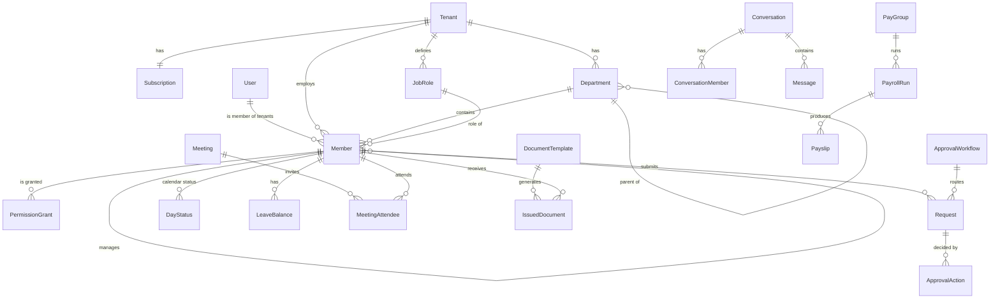

# Data model

Source of truth: [`packages/db/prisma/schema.prisma`](../packages/db/prisma/schema.prisma) (PostgreSQL, Prisma 7). Row-level security: [`packages/db/sql/rls.sql`](../packages/db/sql/rls.sql).

## Core relationships

## Key design decisions

| Decision | Why |
| --- | --- |
| `User` (login) is separate from `Member` (employee in one tenant) | One person can belong to several companies with one login. |
| Every tenant-owned table has `tenantId` + RLS policy | Isolation is enforced by PostgreSQL even if an API check is missed. The API runs `SET LOCAL app.tenant_id` per transaction as the `hr_app` role. |
| Permissions are `action + scope` grants, separate from job roles | Lets the admin delegate "approve leave for Engineering" without making someone an admin. |
| One `Request` table for leave, WFH, OOO, document and payslip requests | One approval engine, one inbox, one history. Type-specific fields live in `details`. |
| `DayStatus` is materialised | The calendar month/year views read one indexed table instead of joining requests, holidays and patterns. |
| Salary, bank details, national IDs and payslip lines are stored encrypted (`*Enc` bytes) | Field-level encryption with per-tenant keys; DB access alone cannot read pay data. |
| Chat `Message` stores ciphertext only | End-to-end encryption; the server cannot read messages. |
| `AuditLog` is append-only for the app role | Tamper-evident record of admin actions and seal/signature use. |

## Verified

- `prisma validate` passes and `prisma migrate dev` creates all 40 tables on PostgreSQL 16.
- `sql/rls_test.sql` (run as `hr_app`): each tenant sees only its own departments and its own tenant row, no tenant set returns 0 rows, and a cross-tenant insert is rejected by policy.
